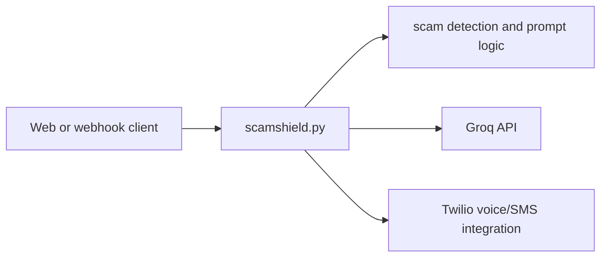

# Tecknotsava ScamShield

A Flask service that evaluates suspicious messages/calls and can use Groq analysis and Twilio telephony to support scam detection workflows. Render configuration is included for a production web service.

## Architecture



## Setup

```bash
python -m venv .venv && . .venv/bin/activate
pip install -r requirements.txt
cp .env.example .env
flask --app scamshield run --debug
```

Required integrations are configured with `GROQ_API_KEY`, `TWILIO_ACCOUNT_SID`, `TWILIO_AUTH_TOKEN`, `TWILIO_PHONE_NUMBER`, and `BASE_URL`; keep them outside Git.

## Deployment

`render.yaml` installs requirements and runs `gunicorn scamshield:app --bind 0.0.0.0:$PORT --workers 2 --timeout 60`. Configure HTTPS and set Twilio webhook URLs to the deployed service.

## Security and limitations

Treat message content and model output as untrusted. Add authentication, rate limiting, request-signature validation for webhooks, audit logging, and privacy/retention controls before handling real call or message data. No automated test suite is configured.

## Security and operations

- Keep credentials, database URLs, OAuth tokens, API keys, and signing secrets in environment variables; never commit them.
- Validate and constrain uploaded files and user input at the server boundary, and enable HTTPS in production.
- Review dependency updates and rotate any credential that has appeared in repository history.

## Testing

The repository currently has no comprehensive automated test suite unless noted above. Before production changes, add tests for authentication/authorization, validation failures, persistence errors, and the primary user workflow.

## Limitations and roadmap

This is an actively evolving project. Production hardening, observability, rate limiting, backup/retention policy, and accessibility/performance validation should be completed before handling sensitive or high-volume workloads.

## License

See the repository license file and package metadata for the authoritative terms.
## Implementation notes

`scamshield.py` exposes the Flask service and Twilio webhook workflow. The implemented endpoints include `/voice`, `/answer/<question_num>`, `/status`, `/api/alerts`, `/api/metrics`, `/api/call-event`, `/api/analyze-call`, and `/health`. Groq is used for analysis, while Twilio handles voice/SMS interaction; `render.yaml` supplies the Render deployment contract.

### Security and operations

Before production use, authenticate operator endpoints, validate Twilio signatures, rate-limit public analysis routes, redact phone numbers/transcripts in logs, and define retention/consent rules. Treat model classifications as assistance rather than definitive fraud determinations. Test webhook retries, malformed TwiML requests, provider timeouts, and duplicate call events.

### License status

No dedicated license file is present in the inspected tree; license terms are unspecified.
